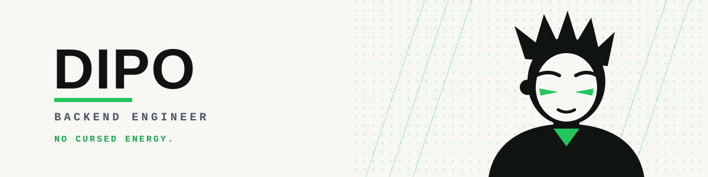
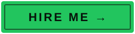
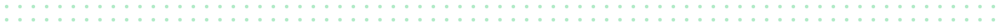
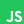
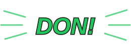
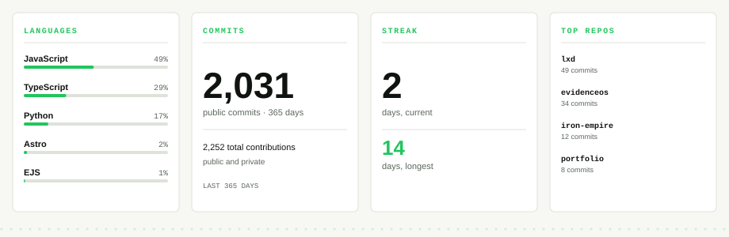
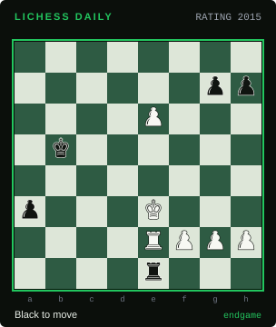

  <picture>
    <source media="(prefers-color-scheme: dark)" srcset="assets/mascot/banner-dark.svg">
    
  </picture>

<h1 align="center">No cursed energy. Just fundamentals.</h1>

<strong>Backend engineer. Ships APIs that don't fall over.</strong>

  Backend engineer in Ile-Ife, Nigeria. Python, Go and TypeScript, with FastAPI, Flask, Django, NestJS, Postgres, MongoDB, Redis, Docker and Kubernetes in the stack. 
  I build APIs that hold their shape under load — 99.95% uptime, 2,500 concurrent users, queries 35% faster. 
  MBBS student at OAU. Open to remote backend roles and select freelance work.

  

  <a href="https://olamidipupo-favour.github.io/work-with-me/"><strong>Work with me</strong></a>
  &nbsp;·&nbsp;
  <a href="https://olamidipupo-favour.github.io/notes/"><strong>Read my notes</strong></a>

  

## CHAPTER 01 · NOW BUILDING

<!-- BLOCK:now -->
Shipping backend work, studying medicine, and taking on remote roles.
<!-- /BLOCK:now -->

## CHAPTER 02 · STACK

| | | | | |
|:--|:--|:--|:--|:--|
|  **Python** |  **Go** |  **TypeScript** |  **JavaScript** |  **Solidity** |
|  **FastAPI** |  **Flask** |  **Django** |  **NestJS** |  **Node.js** |
|  **Next.js** |  **React** |  **PostgreSQL** |  **MongoDB** |  **Supabase** |
|  **Redis** |  **Docker** |  **Kubernetes** |  **GitHub Actions** |  **Tailwind CSS** |

  

## CHAPTER 03 · SELECTED WORK

**[studyBuddyBackend](https://github.com/Olamidipupo-favour/studyBuddyBackend)** — Flask API for a study app: JWT auth, notes, folders, quizzes, summaries and uploads.  
`Python` `Flask` `PostgreSQL` `Redis` `Docker`

**[studyBuddy](https://github.com/Olamidipupo-favour/studyBuddy)** — The Next.js client: auth, subjects, notes, quizzes and a study chat.  
`Next.js` `TypeScript` `Tailwind`

**[evidenceos](https://github.com/Olamidipupo-favour/evidenceos)** — FastAPI and Postgres workspace for medical evidence reviews, with agent-operable browser tools.  
`Python` `FastAPI` `SQLAlchemy` `PostgreSQL` `Next.js`

**[Givsimple-Info](https://github.com/Olamidipupo-favour/Givsimple-Info)** — Turns an NFC tap into a dynamic payment redirect, with an admin console and an audit trail.  
`Flask` `PostgreSQL` `Redis` `Docker`

**[alertMFB-RBAC](https://github.com/Olamidipupo-favour/alertMFB-RBAC)** — NestJS and Prisma RBAC service: JWT auth, role assignment, Swagger docs and e2e tests.  
`NestJS` `Prisma` `TypeScript`

**[dido-dev](https://github.com/Olamidipupo-favour/dido-dev)** — A web3 donation platform: Solidity contracts, a subgraph and a Flask/Mongo backend.  
`Solidity` `The Graph` `Flask` `MongoDB`

  

## CHAPTER 04 · THE NUMBERS

  

| Proof | Value |
|:--|:--|
| Uptime | **99.95%** |
| Concurrent users at peak | **2,500** |
| Query response time | **down 35%** |
| Peak-load downtime | **cut 50%** with Kubernetes autoscaling |
| Active users on Tekcify software | **10,000+** |
| Hackathon wins | **4+** |

<!-- BLOCK:stats -->

  <picture>
    <source media="(prefers-color-scheme: dark)" srcset="assets/generated/stats-dark.svg">
    
  </picture>

<!-- /BLOCK:stats -->

  

## CHAPTER 05 · NOTES FROM THE TERMINAL

<!-- BLOCK:posts -->
_No notes published yet. The feed is live at [rss.xml](https://olamidipupo-favour.github.io/rss.xml)._
<!-- /BLOCK:posts -->

[Read my notes →](https://olamidipupo-favour.github.io/notes/)

  

## CHAPTER 06 · RECENT ACTIVITY

<!-- BLOCK:activity -->
- [Olamidipupo-favour/studyBuddy](https://github.com/Olamidipupo-favour/studyBuddy) — open-sourced · 31 Dec
- [Olamidipupo-favour/Olamidipupo-favour](https://github.com/Olamidipupo-favour/Olamidipupo-favour) — pushed · 03 Nov
- [Olamidipupo-favour/spotifyApi-nest](https://github.com/Olamidipupo-favour/spotifyApi-nest) — pushed · 31 Oct
- [Olamidipupo-favour/ponytail](https://github.com/Olamidipupo-favour/ponytail) — pushed · 31 Oct
- [MuffinDdev001/church-meembership](https://github.com/MuffinDdev001/church-meembership) — pushed · 31 Oct
<!-- /BLOCK:activity -->

  

## CHAPTER 07 · OFF DUTY

Chess, violin and maths. I play all three badly enough to keep enjoying them.

Also: sciences, finance, fitness, anime and manga.

<!-- BLOCK:chess -->

Daily puzzle · rating 1954 · [Play on Lichess →](https://lichess.org/training/FPFg0)
<!-- /BLOCK:chess -->

  

## CHAPTER 08 · SAY HELLO

Hiring for a backend role? [Email me](mailto:dipoagboola2019@gmail.com?subject=Hiring%3A%20Backend%20Engineer) with the role and the problem. Everyone else: [read the notes](https://olamidipupo-favour.github.io/notes/) or send a note about chess.

- Email: [dipoagboola2019@gmail.com](mailto:dipoagboola2019@gmail.com)
- Portfolio: [olamidipupo-favour.github.io](https://olamidipupo-favour.github.io)
- GitHub: [@Olamidipupo-favour](https://github.com/Olamidipupo-favour)
- LinkedIn: [olamidipupo-agboola](https://www.linkedin.com/in/olamidipupo-agboola-6b3917237)
- X: [@zeus_odin009](https://x.com/zeus_odin009)
- Lichess: [@dipo12](https://lichess.org/@/dipo12)

  

Updated every six hours by a small bot. GitHub pauses scheduled workflows after 60 days of repository inactivity; the bot's own commits keep this one awake. No CSS, no JavaScript, no cursed energy.

